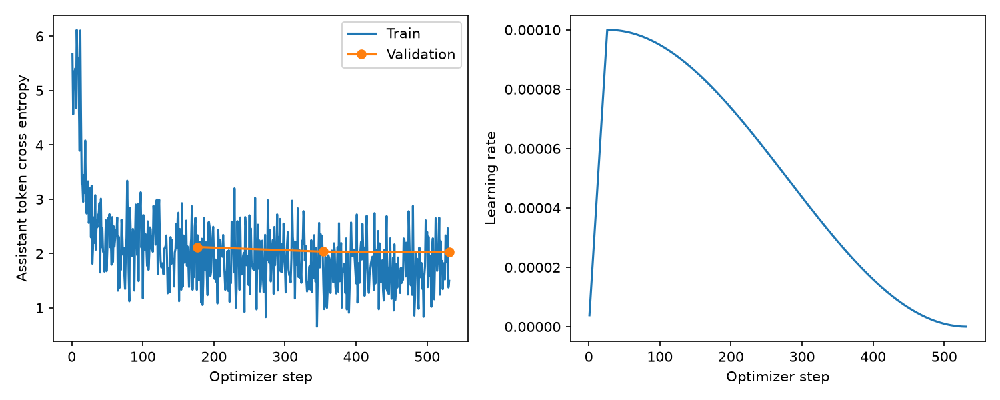
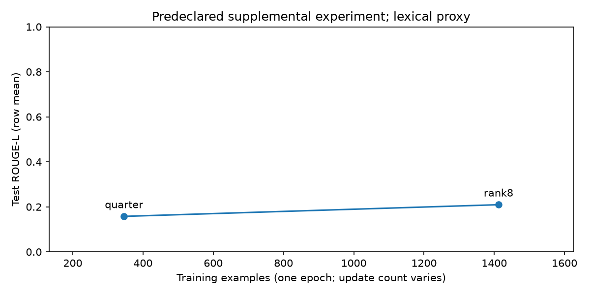
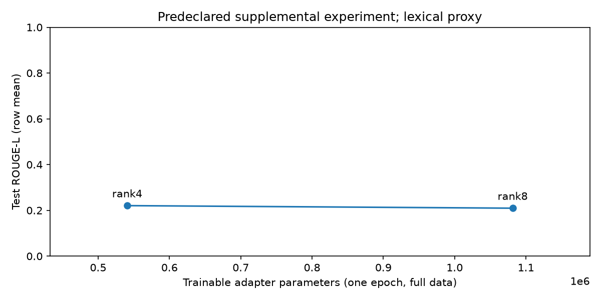

# CommunityQwen: measured project report

Held-out ROUGE-L improved from 0.0352 to 0.2967 and assistant-token perplexity fell from 161.97 to 7.74. However, the adapter still makes clear meaning errors, and much shorter answers contribute to the overlap gain. It is not a reliably accurate contextual slang interpreter.

The existing local Qwen2.5-0.5B-Instruct checkpoint was reused for an explicit PyTorch LoRA experiment on contextual slang/acronym explanation. The project completed data audit, zero/few-shot controls, real-model smoke/reload checks, three-epoch LoRA training, frozen held-out evaluation, context/rank/data ablations, a two-seed one-epoch repeatability check, OOD diagnostics and a general-capability sanity suite. QLoRA is guarded and unrun on MPS. Human semantic review remains outstanding.

## Environment and checkpoint

- Checkpoint: `models/Qwen2.5-0.5B-Instruct`
- Base architecture: Qwen2ForCausalLM (Qwen2.5), 494,032,768 unique parameters.
- Device: Apple M3 MPS, 8 GB unified memory. BF16 base, FP32 PEFT adapters (verified in the saved safetensors header).
- Python: 3.13.3 (v3.13.3:6280bb54784, Apr  8 2025, 10:47:54) [Clang 15.0.0 (clang-1500.3.9.4)]
- Versions: torch 2.13.0, transformers 5.15.0, peft 0.20.0, datasets 5.0.1, accelerate 1.14.0.
- Frozen weight/config/tokenizer SHA-256 hashes: `checkpoint_sha256.json`; the local weight hash matches the [published checkpoint hash](https://huggingface.co/Qwen/Qwen2.5-0.5B-Instruct/blob/main/model.safetensors). No base download; dataset/dependency downloads only. Training and inference use local files without paid APIs.

## Dataset and task validity

1779 raw rows; 1772 retained rows; 1539 normalized terms. Train/validation/test have 1,412/179/181 rows and 1,231/154/154 terms. Seven records were quarantined: three duplicate examples, two empty normalized terms and two too-short definitions. Missing cells: {'Slang': 0, 'Description': 0, 'Example': 0, 'Context': 0}.

The Example field is usage; Description is the weak target. Context metadata is excluded because it often reveals the answer. Normalized term groups and exact usage-sentence checks prevent measured cross-split overlap. The original descriptions are not independently adjudicated and can be ambiguous or inaccurate. Uppercase terms occupy 1,260/1,412 training rows, so results primarily concern an acronym-heavy corpus rather than broad Gen-Z language competence.

Training token-length percentiles: {'p50': 71.0, 'p75': 74.0, 'p90': 78.0, 'p95': 82.0, 'p99': 96.8900000000001, 'max': 118.0}. Sequence budget 128, no training truncation. Tokenizer base vocabulary 151,643, including added entries 151,665; embedding/head rows 151,936. EOS `<|im_end|>`, PAD `<|endoftext|>`. Tokenization examples and audit details are in `dataset_audit.md` and `data_quality_notes.md`.

## Architecture learned

Embedding width 896; 24 decoder layers; 14 query heads / 2 KV heads, dimension 64 (GQA). Query/key/value projections feed scaled causal attention, with an output projection and residual connection. RMSNorm precedes sublayers; gated SiLU MLP projections expand to 4,864 and return to 896. RoPE supplies positional information; context configuration is 32,768. The LM head shares the token embedding weights. See `../docs/qwen_architecture.md` and the actual module inspection JSON.

## Training and reliability

Q/K/V/O LoRA, rank 8, alpha 16, dropout .05. 1,081,344 adapter parameters, 0.2184% of base plus adapters. All 494,032,768 base parameters remain frozen. AdamW LR 1e-4, weight decay .01, cosine schedule, 5% warmup, micro-batch 1 × accumulation 8, effective nominal batch 8. Gradient norm clipped to 1.0 after correctly weighting each micro-batch by supervised assistant tokens.

Completed status: **completed**, 531 updates, 3 epochs, 4236 example exposures and 27651 assistant target tokens. Runtime 921.5 seconds (15.4 minutes). Initial full-validation CE 5.5334; best validation CE 2.0328. First optimizer-window loss 5.6663; last window loss 1.4997. Those windows contain different examples, so they are not a paired metric.

Observed maximum unclipped gradient norm 39.611. Sampled peak MPS tensor allocation 1.143 GB; final MPS driver allocation 3.418 GB. These are process/device allocator measurements, not peak total system unified-memory usage; CPU RSS is separately logged. The real-model adapter reload matched logits. A tiny real Qwen test verifies checkpoint continuation, partial accumulation and early stopping. Best adapter selection uses validation only.

| Epoch | Validation CE |
|---|---:|
| 1 | 2.1217 |
| 2 | 2.0366 |
| 3 | 2.0328 |



## Final unseen-term comparison

The adapter is not a reliably accurate slang interpreter: clear semantic errors remain despite improved reference metrics. See the qualitative case review and length-stratified analysis before interpreting overlap gains.

All conditions use the same 181 frozen rows / 154 normalized terms and greedy decoding. Scores below are row-mean ROUGE-L lexical overlap, not semantic accuracy. Memory is the final MPS driver allocator sample during evaluation, not peak training memory.

| Model | Trainable parameters during adaptation | Eval driver memory GB | Test ROUGE-L | Test PPL | OOD ROUGE-L |
|---|---:|---:|---:|---:|---:|
| Base zero-shot | 0 | 2.226 | 0.0352 | 161.97 | 0.1151 |
| Base few-shot | 0 | 3.293 | 0.0727 | 41.36 | not run |
| LoRA | 1,081,344 | 2.234 | 0.2967 | 7.74 | 0.1691 |

QLoRA: not run; no measured quantization or efficiency comparison. Full-weight fine-tuning: not run, so “most of its gains” cannot be claimed for LoRA.

## Paired statistics and uncertainty

```json
{
  "Base few-shot": {
    "metric": "rouge_l",
    "base_term_macro": 0.036281943754320416,
    "tuned_term_macro": 0.07455410233978768,
    "units": 154,
    "mean_delta": 0.038272158585467266,
    "std_delta": 0.15279478121476628,
    "ci95": [
      0.01571802453523728,
      0.0639567584076964
    ],
    "method": "paired bootstrap over normalized terms; fixed trained model, not training-seed uncertainty",
    "seed": 42,
    "repetitions": 10000,
    "exploratory_permutation_p": 0.0006999300069993001
  },
  "LoRA": {
    "metric": "rouge_l",
    "base_term_macro": 0.036281943754320416,
    "tuned_term_macro": 0.30172052346817235,
    "units": 154,
    "mean_delta": 0.265438579713852,
    "std_delta": 0.330173082453437,
    "ci95": [
      0.21401595248054925,
      0.3179591246448135
    ],
    "method": "paired bootstrap over normalized terms; fixed trained model, not training-seed uncertainty",
    "seed": 42,
    "repetitions": 10000,
    "exploratory_permutation_p": 9.999000099990002e-05
  }
}
```

Terms, not repeated rows, are the resampling units. Intervals condition on one selected main adapter; they do not estimate training-seed uncertainty. Permutation p-values are exploratory and unadjusted for multiple comparisons. Reference bias and output-length changes can affect overlap. No confirmatory significance or semantic-accuracy claim is made.

## Ablations and repeatability

See [actual ablations](ablations.md) for the prompt/context diagnostic (whose wording also changes) and the predeclared one-epoch rank/data controls. Alpha is held fixed in the rank experiment; the data-size comparison keeps epochs fixed and therefore varies total updates.





```json
{
  "training_seeds": [
    42,
    123
  ],
  "split_seed": 42,
  "epochs": 1,
  "mean_test_rouge_l": 0.217882903471127,
  "sample_std_test_rouge_l": 0.011891988885321335,
  "limitation": "Two seeds only; no reliable seed-distribution confidence interval. Main three-epoch run has one seed."
}
```

## OOD and general-capability checks

The technical OOD set contains 12 assistant-authored, source-linked examples with no normalized-term overlap against any split. It is a small diagnostic, not an external human-validated benchmark.

General checks contain 25 prompts: 20 objective short-answer cases and five summaries awaiting review. Strict case/text/format checks may mark verbose or case-varied answers wrong; this is a format-sensitive sanity check.

```json
{
  "Base": {
    "reasoning": {
      "correct": 1,
      "total": 5,
      "strict_accuracy": 0.2
    },
    "factual": {
      "correct": 3,
      "total": 5,
      "strict_accuracy": 0.6
    },
    "instruction": {
      "correct": 3,
      "total": 5,
      "strict_accuracy": 0.6
    },
    "coding": {
      "correct": 0,
      "total": 5,
      "strict_accuracy": 0.0
    }
  },
  "LoRA": {
    "reasoning": {
      "correct": 4,
      "total": 5,
      "strict_accuracy": 0.8
    },
    "factual": {
      "correct": 5,
      "total": 5,
      "strict_accuracy": 1.0
    },
    "instruction": {
      "correct": 3,
      "total": 5,
      "strict_accuracy": 0.6
    },
    "coding": {
      "correct": 3,
      "total": 5,
      "strict_accuracy": 0.6
    }
  }
}
```

See [general-capability interpretation](general_findings.md) for the 7/20 → 15/20 strict result, its exact-copy regression, and qualitative summarization losses.

## Error analysis and remaining evidence

[Descriptive strata](stratified_results.md) compare uppercase terms and reference lengths, alongside output brevity, to expose possible format effects.

[Selected qualitative cases](qualitative_cases.md) give explicitly labeled assistant judgments, including real improvements, both-fail examples and lexical-metric counterexamples. These are not independent human labels.

[Error analysis](error_analysis.md) lists the largest lexical increases/decreases with source IDs, contexts, weak references and both model outputs. These are review candidates; they must not be silently converted into “base wrong / tuned correct” labels. Paired human correctness, wrong sense, context ignored, hallucination, generic answers, excessive slang style and possible memorization fields are prepared in `paired_human_review.jsonl`. Independent semantic review has not been performed.

The next decisive experiment is blinded human annotation of these frozen predictions, including reference disputes and low-overlap paraphrases. Do not change prompts or tune on the inspected test errors. Any test-informed redesign needs fresh confirmation data. Additional optimization/regularization sweeps and independently sourced extra context remain available as future exercises, not completed results.

## Verification and learning deliverables

See `pytest.txt` for the current actual test count, and `artifact_verification.json` for exact evaluation coverage, recomputed scores and unchanged split hashes. All generated examples are saved. Scientific plots derive only from observed runs. The measured numerical runs used archived execution source v1/v2; packaged v3 adds optional AUTO_DISCOVER identity handling only, an unexercised branch for every measured explicit-path run. Source archives and config/environment manifests preserve run provenance; checkpoint fingerprints reject mismatched code/config/data.

[93-concept checklist](../docs/concept_checklist.md), [12-file study guide and 16 exercises](../docs/study_guide.md), [PyTorch foundations](../docs/pytorch_foundations.md), [Transformer concepts](../docs/transformer_concepts.md), [LoRA](../docs/lora.md), [QLoRA limits](../docs/qlora.md), and [research-question boundaries](../docs/research_questions.md).
